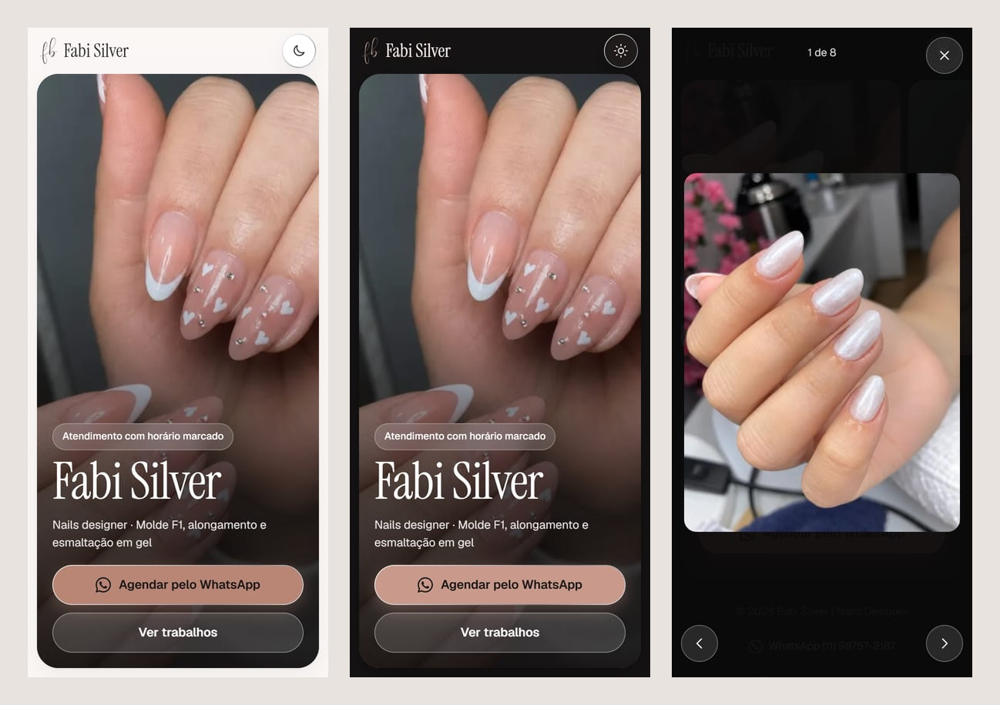

# Fabi Silver: cartão digital para nail designer

Cartão digital de uma página para a **Fabi Silver**, nail designer que trabalha com Molde F1, alongamento de unhas e esmaltação em gel. A cliente abre o link, vê os serviços e os trabalhos e agenda pelo WhatsApp com a mensagem já preenchida.

O diferencial é ser **leve e direto ao ponto**: HTML, CSS e JavaScript puros, sem build e sem dependências, com fotos otimizadas em WebP e o botão de agendamento sempre à mão no celular.


🌐 **Acesse:** https://kondoca.github.io/Card-FabiSilver/

## Funcionalidades

**Para a cliente**
- Seções de Serviços, Trabalhos, Sobre e Agendamento, com menu de navegação por âncoras
- Agendamento pelo WhatsApp (`wa.me`) com mensagem pronta, e botão fixo no rodapé da tela no celular
- Galeria com seis trabalhos da Fabi e link para o Instagram do estúdio
- Modo claro e modo noturno

**Desempenho e acessibilidade**
- Fotos em WebP em dois tamanhos (480px e original), escolhidos pelo navegador via `srcset`/`sizes`
- `loading="lazy"` nas imagens abaixo da dobra e `fetchpriority="high"` na foto de abertura
- `width`/`height` em todas as imagens, para a página não "pular" enquanto carrega
- Texto alternativo descritivo em todas as fotos e link "Pular para o conteúdo"

**Compartilhamento**
- Tags Open Graph e Twitter Card com imagem de prévia (`share.jpg`), para o link aparecer bonito no WhatsApp e nas redes
- Favicon e ícone para a tela inicial do iPhone (`apple-touch-icon.png`)
- `theme-color` diferente para o modo claro e o noturno

## Como o modo noturno funciona

```
1ª visita      → um script no <head> aplica o tema do aparelho (prefers-color-scheme) antes da primeira pintura
clique no botão → alterna claro/noturno e salva a escolha no localStorage
sem escolha salva → a página acompanha a mudança de tema do sistema em tempo real
```

As cores do modo noturno ficam em `index.html`, no bloco `:root[data-theme="dark"]`. Em navegação privada, onde o `localStorage` pode falhar, a escolha vale só para aquela visita.

| Modo noturno | Galeria de trabalhos | No celular |
|---|---|---|
|  |  |  |

## Tecnologias

- HTML5 semântico
- CSS puro com variáveis (tokens de design, grid e componentes)
- JavaScript em módulos ES, sem frameworks
- Imagens WebP responsivas
- GitHub Pages

## Rodando localmente

Os scripts são módulos ES, então a página precisa ser aberta por um servidor (não por `file://`):

```bash
npx serve .
```

ou

```bash
python -m http.server 8080
```

## Deploy

O site é publicado direto da branch `main` pelo GitHub Pages. Para ativar, vá em **Settings → Pages → Source: Deploy from a branch**, branch `main`, pasta `/ (root)`.

Com um domínio próprio, ative a linha `<link rel="canonical">` no `<head>` e troque o `og:image` por uma URL absoluta (`https://dominio/share.jpg`), que algumas redes exigem.

## Estrutura

```
├── index.html             # a página
├── css/
│   └── page.css           # estilos próprios da página (inclui o modo noturno)
├── js/
│   └── tema.js            # botão de modo claro / noturno
├── assets/                # sistema de design
│   ├── system.css/js      # tokens e base
│   ├── layout/            # grid e layout das seções
│   ├── ui/                # botões, cards e menu
│   ├── motion/            # animações de entrada
│   └── moments/           # efeito de rolagem da seção Sobre
├── img/                   # fotos em WebP (480px e original), monograma e retrato
├── docs/                  # imagens usadas neste README
├── favicon-32.png
├── apple-touch-icon.png
└── share.jpg              # imagem de prévia nas redes
```

## Trocar ou adicionar fotos na galeria

1. Gere as versões WebP (por exemplo, no [squoosh.app](https://squoosh.app)): `img/unhaX-480.webp` e `img/unhaX-<largura>.webp`.
2. Em `index.html`, na seção `#trabalhos`, copie um `<figure>` e troque `src`, `srcset`, `width`, `height` e `alt`.
3. Mantenha 3 fotos por linha (o layout espera grupos de três).

`img/unha10-*.webp` já está convertida e pronta para entrar na galeria.

## Próximos passos

- Domínio próprio para a Fabi, com `canonical` e `og:image` absolutos
- Informações de região de atendimento e formas de pagamento
- Mais trabalhos na galeria, incluindo a `unha10`

## Sobre

Projeto desenvolvido por [Kondoca](https://github.com/kondoca) para uma cliente real. Fotos, textos e contato pertencem à Fabi Silver.
