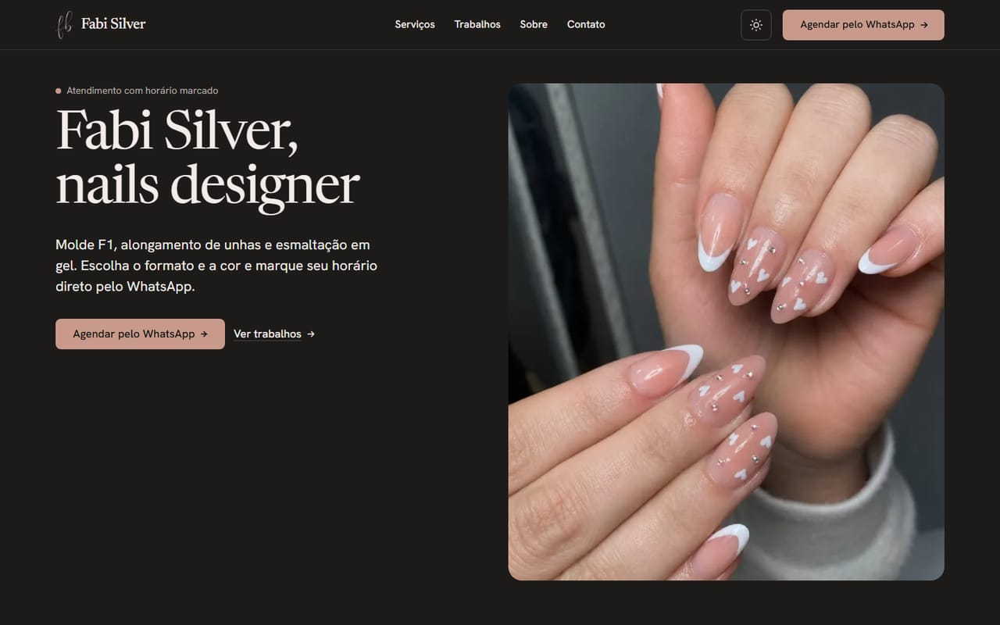
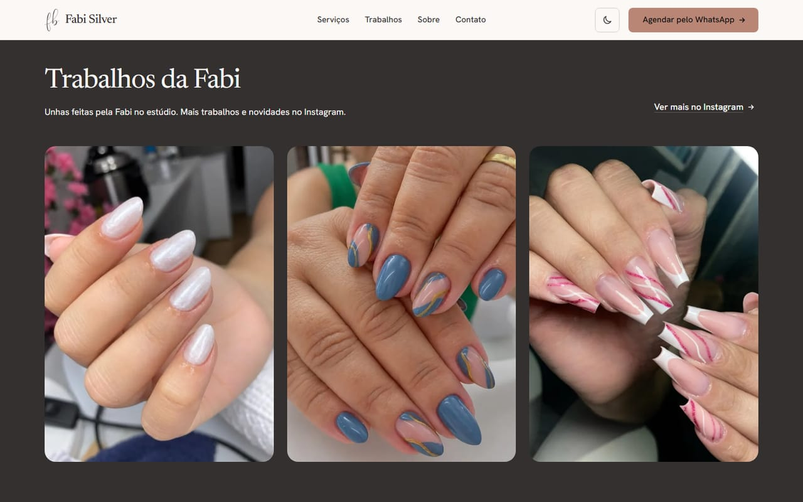

# Fabi Silver | Nails Designer: cartão digital

Página única, estática (HTML, CSS e JavaScript), sem build e sem dependências.

## Como ficou

**Abertura no computador (modo claro)**


**Abertura no computador (modo noturno)**



**Galeria de trabalhos**



**No celular, modo claro e noturno**


## Estrutura

```
index.html            a página
docs/                 imagens usadas neste README
css/page.css          estilos próprios da página (inclui o modo noturno)
js/tema.js            botão de modo claro / noturno
assets/               sistema de design: tokens, grid, botões, menu, animações e o efeito de rolagem da seção Sobre
img/                  fotos em WebP (480px e tamanho original), monograma do logo e retrato
favicon-32.png, apple-touch-icon.png, share.jpg (imagem de compartilhamento nas redes)
```

`img/unha10-*.webp` já está convertida e pronta para entrar na galeria.

## Modo noturno

O botão com lua/sol no menu alterna entre claro e noturno. Na primeira visita a página segue o tema do
aparelho; depois de um clique, a escolha fica salva no navegador. As cores do modo noturno estão em
`index.html`, no bloco `:root[data-theme="dark"]`.

## Rodar localmente

Os scripts são módulos ES, então abra a página por um servidor (não por `file://`):

```
npx serve .            # ou: python -m http.server 8080
```

## Trocar ou adicionar fotos na galeria

1. Gere as versões WebP (ex.: em squoosh.app): `img/unhaX-480.webp` e `img/unhaX-<largura>.webp`.
2. Em `index.html`, seção `#trabalhos`, copie um `<figure>` e troque `src`, `srcset`, `width`, `height` e `alt`.
3. Mantenha 3 fotos por linha (o layout espera grupos de três).

## Publicar no GitHub Pages

1. No repositório: Settings > Pages > Source: "Deploy from a branch", branch `main`, pasta `/ (root)`.
2. O site fica em `https://kondoca.github.io/Card-FabiSilver/`.
3. Com um domínio próprio, ative a linha `<link rel="canonical">` no `<head>` e troque `og:image` por uma URL
   absoluta (`https://dominio/share.jpg`), que algumas redes exigem.
