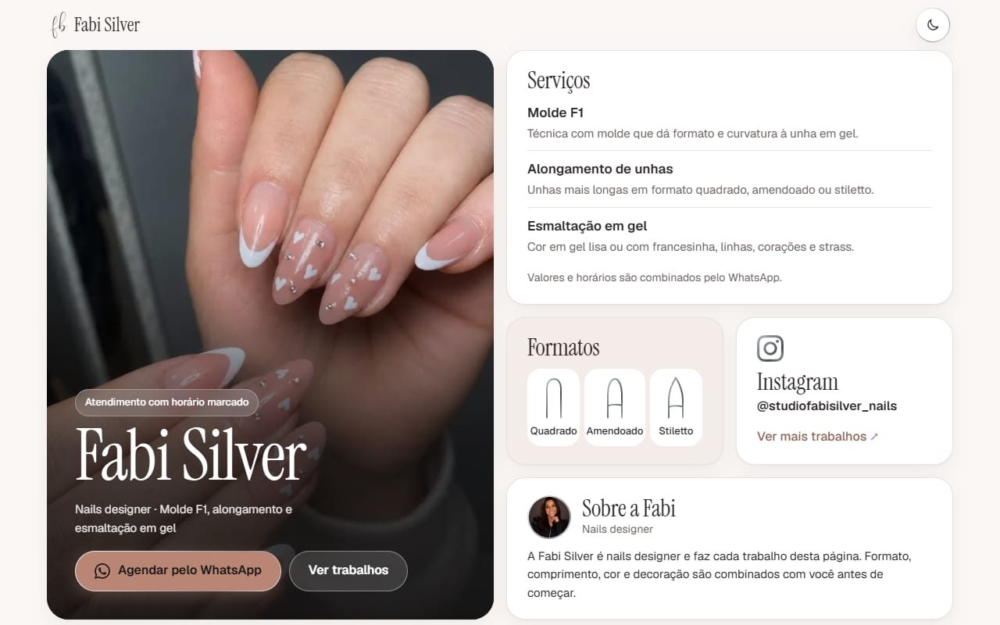

# Fabi Silver | Nails Designer: cartão digital

**Site no ar:** https://kondoca.github.io/Card-FabiSilver/

Cartão digital no estilo "link na bio", feito primeiro para o celular (a maioria das visitas vem do
Instagram). Página única, estática (HTML, CSS e JavaScript), sem build e sem dependências.

## Como ficou

**Computador, modo claro:** a foto grande com o nome à esquerda e os blocos em bento à direita.



**Computador, modo noturno**


**Galeria de trabalhos:** carrossel que dá para arrastar no celular, com setas no computador.


**Celular:** modo claro, modo noturno e a foto ampliada (lightbox).


## O que tem na página

- **Abertura:** foto grande com o nome "Fabi Silver" por cima e o botão de agendar, sem precisar rolar.
- **Blocos (bento):** Serviços, Formatos (quadrado, amendoado e stiletto), Instagram e Sobre.
- **Galeria:** carrossel com scroll-snap; tocar numa foto abre o lightbox (setas, arrastar para o lado, Esc ou X para fechar).
- **Agendamento:** todos os botões abrem o WhatsApp com a mensagem já escrita. No celular, uma barra fixa
  com o botão aparece ao rolar a página.
- **Modo claro e noturno:** botão com lua/sol no topo. Na primeira visita segue o tema do aparelho; depois
  de um clique, a escolha fica salva no navegador.
- **Acessibilidade:** contraste AA nos dois temas, foco visível, link para pular ao conteúdo, textos
  alternativos e respeito a `prefers-reduced-motion` (sem animações para quem prefere menos movimento).

## Visual

- **Cores:** rosé do logo como cor principal (`#b98676`; `#c99a8b` no noturno), branco quente `#faf7f5` /
  grafite `#141212` de fundo e um cromado prateado sutil em detalhes (borda do botão principal, ícones,
  desenhos dos formatos e o brilho no nome). Todas as cores estão no topo de `css/estilos.css`.
- **Fontes:** Instrument Serif no nome e nos títulos grandes; Geist no resto (Google Fonts).

## Estrutura

```
index.html            a página
css/estilos.css       todo o visual (mobile-first; cores dos dois temas no início do arquivo)
js/main.js            carrossel, lightbox, barra fixa do celular e entrada suave dos blocos
js/tema.js            botão de modo claro / noturno
img/                  fotos em WebP (480px e tamanho original), monograma do logo e retrato
docs/                 imagens usadas neste README
favicon-32.png, apple-touch-icon.png, share.jpg (imagem de compartilhamento nas redes)
```

## Rodar localmente

Os scripts são módulos ES, então abra a página por um servidor (não por `file://`):

```
npx serve .            # ou: python -m http.server 8080
```

## Trocar ou adicionar fotos na galeria

1. Gere as versões WebP (ex.: em squoosh.app): `img/unhaX-480.webp` e `img/unhaX-<largura>.webp`.
2. Em `index.html`, na lista `.carrossel`, copie um `<li>` e troque `src`, `srcset`, `width`, `height`,
   `data-grande` (a versão maior, usada no lightbox) e `alt`.

Não há limite de fotos: o carrossel e o lightbox se ajustam sozinhos.

## Publicar

O site é publicado pelo GitHub Pages a partir da branch `main` (pasta raiz). Cada `git push` atualiza o
site em cerca de um minuto. Com um domínio próprio, ative a linha `<link rel="canonical">` no `<head>` e
troque `og:image` por uma URL absoluta (`https://dominio/share.jpg`), que algumas redes exigem.
